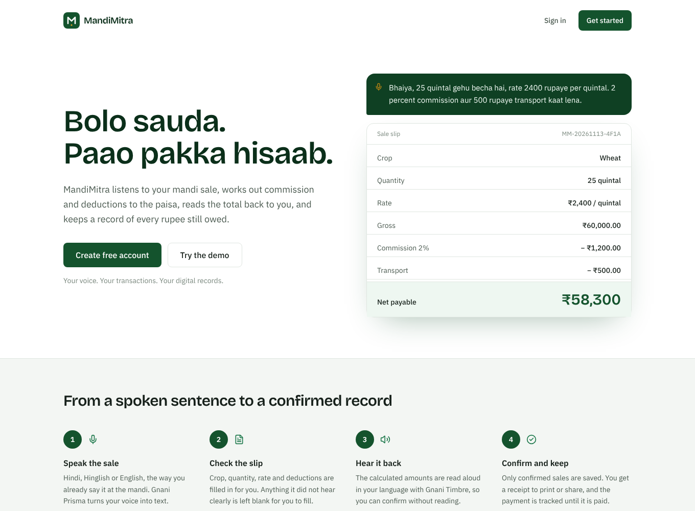
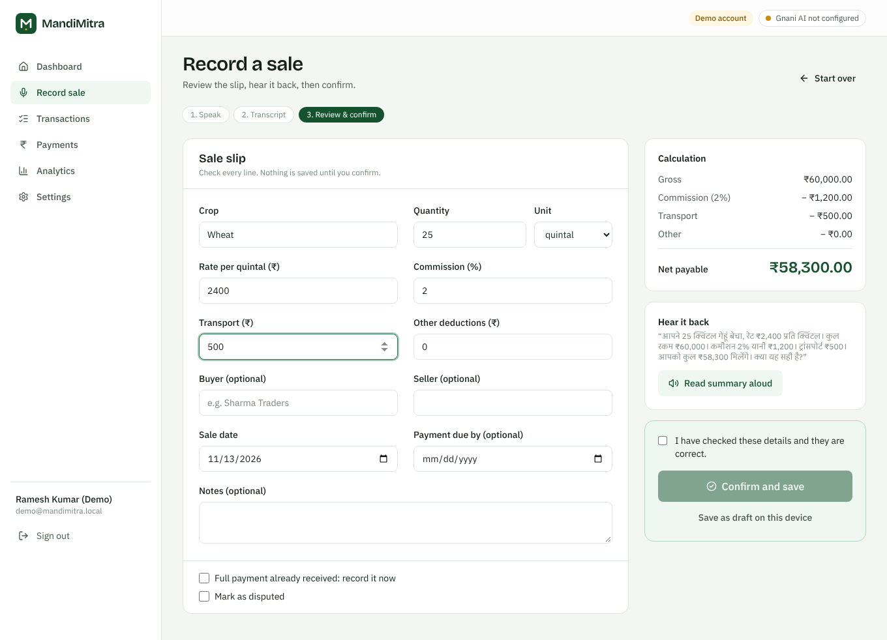
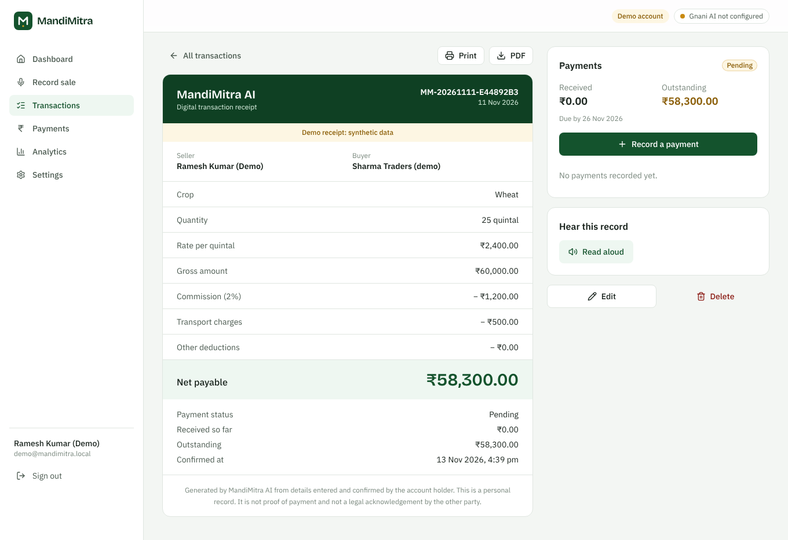
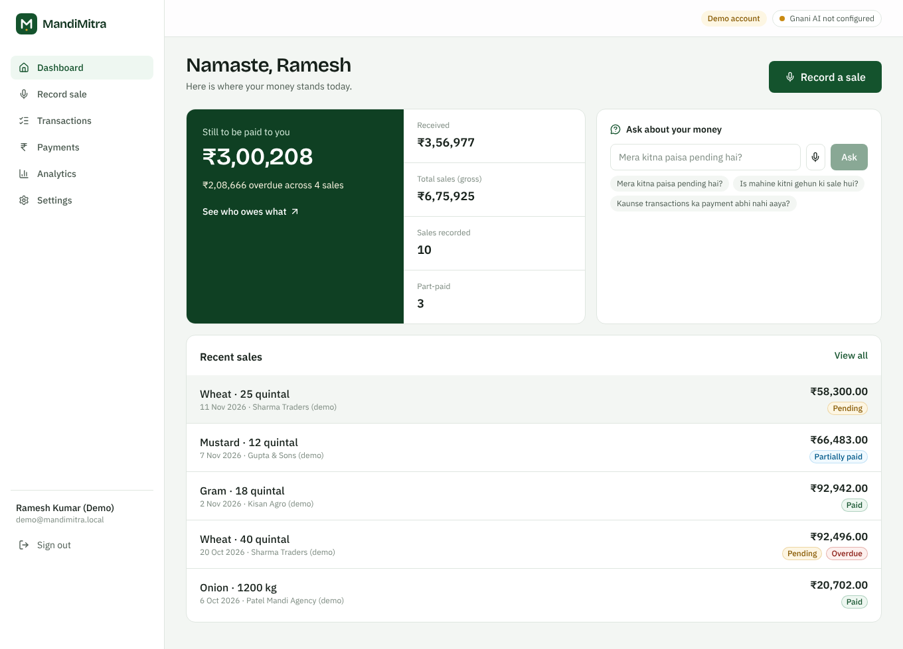
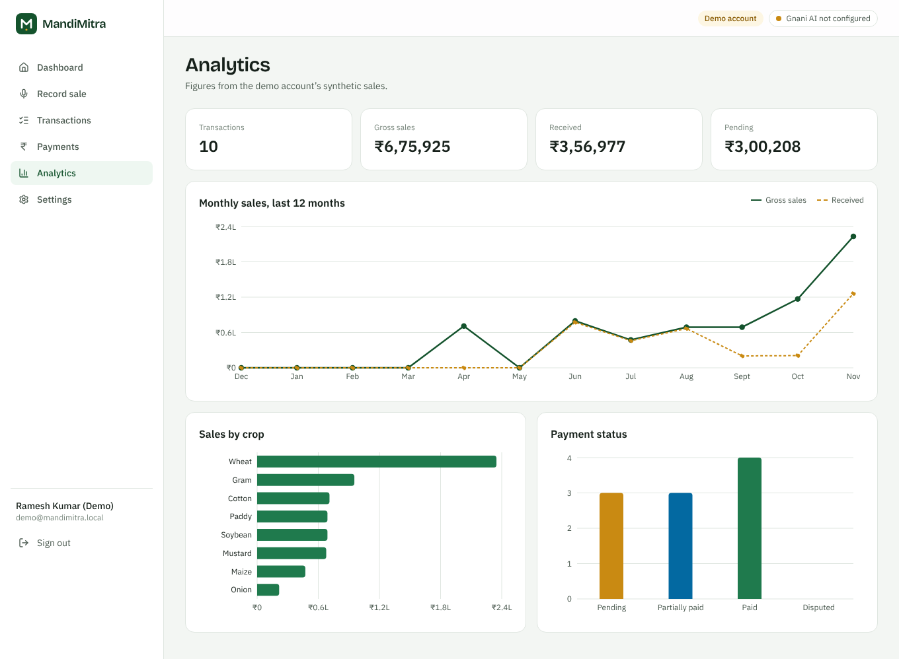
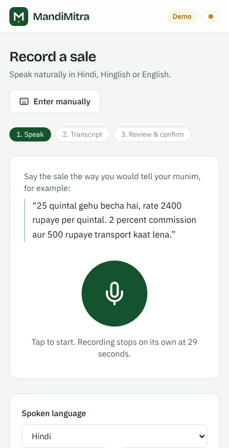
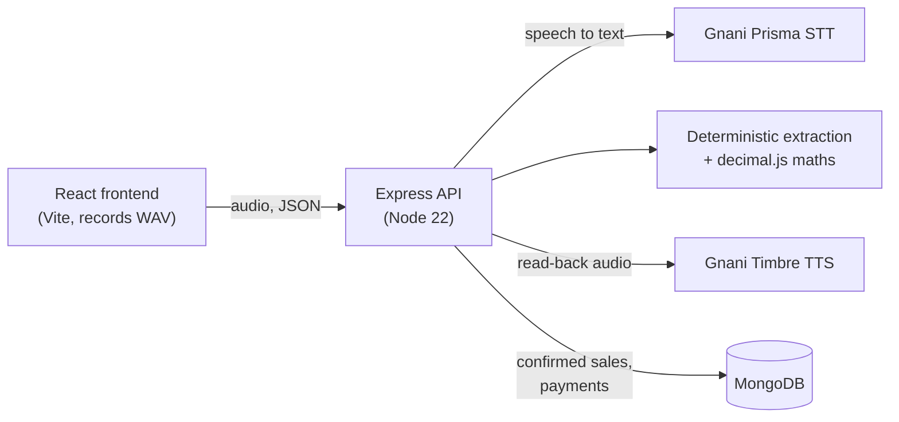

# MandiMitra AI

**Your voice. Your transactions. Your digital records.**

Author: Jitesh Jain, built for the Great Indian AI Internship Challenge. Developed with AI coding assistance.

MandiMitra AI is a voice-first transaction assistant for farmers, traders and mandi workers in India. You speak a sale in Hindi, Hinglish or English. The app transcribes it with **Gnani Prisma**, fills in a sale slip, calculates commission and deductions to the paisa on the server, reads the result back with **Gnani Timbre**, and saves it only after you confirm. It then issues a receipt and tracks the payment until it is paid.

**Status:** runs locally (see [Installation](#installation)). A deployment guide is provided in [DEPLOYMENT.md](DEPLOYMENT.md), but no live deployment is claimed here.

**Jump to:** [Screenshots](#screenshots) · [Demo video](#demo-video) · [Architecture](#architecture) · [Features](#features) · [Run it](#installation) · [Gnani integration](#gnani-ai-integration) · [Tests](#testing) · [Limitations](#known-limitations)

<p align="center">
  
</p>

## Screenshots

Screenshots of the running application. The app screens use the synthetic demo account, so every name and amount is made up.

<table>
  <tr>
    <td width="50%" valign="top">
      
      <br><sub><b>Review and confirm.</b> The spoken sale becomes a slip. The server calculates the net amount, Gnani Timbre reads it back, and nothing is saved until the box is ticked.</sub>
    </td>
    <td width="50%" valign="top">
      
      <br><sub><b>Receipt.</b> Itemised deductions and net payable, with print and PDF. It states that it is a personal record, not proof of payment.</sub>
    </td>
  </tr>
  <tr>
    <td width="50%" valign="top">
      
      <br><sub><b>Dashboard.</b> What is still owed, what has come in, recent sales, and a box to ask questions such as "Mera kitna paisa pending hai?".</sub>
    </td>
    <td width="50%" valign="top">
      
      <br><sub><b>Analytics.</b> Twelve-month trend, sales by crop and payment status, all calculated from the recorded sales.</sub>
    </td>
  </tr>
  <tr>
    <td colspan="2" align="center">
      
      <br><sub><b>On a phone.</b> The record screen at phone width, with the example sentence to say and the large microphone button.</sub>
    </td>
  </tr>
</table>

<sub>Note: these screenshots were captured before a Gnani key was connected, so the header badge reads "Gnani AI not configured" in some of them. With a key set, it shows "Gnani AI connected".</sub>

## Demo video

> **Demo video:** _to be added._ <!-- Replace this line with: [Watch the 2 to 3 minute demo](PUBLIC_VIDEO_URL) -->

A written walkthrough is in [DEMO_SCRIPT.md](DEMO_SCRIPT.md).

## The problem

Most mandi sales are still recorded in paper *bahi-khatas* or not at all. Commission (*aadhat*), transport (*bhada*) and labour (*hammali*) deductions are worked out by hand, and part payments are tracked from memory. Disputes follow. Form-based apps don't help people who would rather speak than type, or who are more comfortable in Hindi than English.

## Features

| Area | What it does |
|---|---|
| Voice capture | Records 16 kHz WAV in the browser (Prisma does not accept the WebM that Chrome records), with a level meter, timer, 29-second auto-stop, cancel, playback before sending, and upload as a fallback. |
| Speech-to-text | Gnani Prisma `prisma-v3.0`. You choose the language, or use automatic detection (`indic-auto`). Hinglish is sent as `hi-IN,en-IN`. Mandi vocabulary is passed as `keyterms`. The transcript can be edited before extraction. |
| Extraction | A deterministic parser for Hindi, Hinglish and English handles Devanagari digits, Hindi and English number words ("do hazaar chaar sau", "saadhe baarah"), units, rate, commission, transport and other deductions. It never guesses: unclear fields stay empty and are highlighted. |
| Calculation | `decimal.js` on the server, integer paise, half-up rounding. The browser and the AI never calculate money. |
| Read-back | Gnani Timbre `timbre-v2.5` with a voice matched to the user's language. Includes replay and download. |
| Confirmation | Nothing is saved until the user ticks "I have checked these details" and confirms. Saves are idempotent, so retries never create duplicates. |
| Receipts | HTML receipt with print support, plus a server-generated PDF (Noto Sans with Devanagari and ₹). Each receipt states clearly that it is not proof of payment. |
| Transactions | Create, view, edit (amounts recalculated) and delete. Search, filter, sort and pagination. CSV export with spreadsheet formula-injection protection. |
| Payments | Partial and full payments with derived status (pending, partially paid, paid; disputed is set manually), overdue detection, payment history, and outstanding balance per sale. |
| Voice questions | "Mera kitna paisa pending hai?" and similar questions map to a fixed whitelist of intents, each running a predefined query scoped to the user. Answers are read aloud. |
| Analytics | Totals, 12-month trend (IST), crop-wise sales and status distribution, all from real data. |
| Offline | Unconfirmed drafts are kept on the device. A sale confirmed while offline is queued and sent with its idempotency key when the connection returns. |
| Help and onboarding | A labelled "How it works" section on the landing page (with a "Try it in 30 seconds" guide), a public guide at `/help` and an in-app guide at `/app/help` (first-sale steps, example sentences in Hindi, Hinglish and English, microphone troubleshooting, page guide, FAQ), and a first-time hint on an empty dashboard that disappears after the first sale. The example sentences are shared constants, and an API test checks the extractor understands every one. |
| Security | Helmet, CORS allowlist, rate limits (per user for Gnani calls), bcrypt, HS256 JWT with server-side logout, strict Zod validation and safe errors. The Gnani key lives only on the backend. |

## Architecture



The Gnani key stays on the API. The browser never talks to Gnani, and the AI never calculates money.

Request flow in detail:

```
Browser (React + Vite)                 API (Express 5, Node 22)                     External
──────────────────────                 ────────────────────────                     ────────
WAV recorder ──multipart──► POST /api/voice/transcribe ─► audio-validation ─► prisma.service ──► Gnani Prisma STT
Review slip ──JSON───────► POST /api/transactions/preview ─► calculation.service (decimal.js)
                           POST /api/voice/speak ──────────► timbre.service ──────────────────► Gnani Timbre TTS
Confirm ───Idempotency-Key► POST /api/transactions ─────────► MongoDB (Mongoose)
Ask ──────────────────────► POST /api/voice/query ──────────► whitelisted intents ─► user-scoped aggregations
```

See [ARCHITECTURE.md](ARCHITECTURE.md) for details and [API_DOCUMENTATION.md](API_DOCUMENTATION.md) for every endpoint.

## Technology stack

- **Frontend:** React 19, Vite 8, TypeScript, Tailwind CSS 4, shadcn/ui-style components (Radix), Lucide, React Router 7, TanStack Query 5, React Hook Form and Zod, Recharts 3, Sonner
- **Backend:** Node 22, Express 5, TypeScript, MongoDB with Mongoose 9, Zod 4, bcryptjs, jsonwebtoken, Helmet, express-rate-limit, Multer (memory storage), decimal.js, PDFKit
- **AI:** Gnani Prisma (STT) and Gnani Timbre (TTS) over REST. Evon is **not** used and nothing depends on it.
- **Testing:** Vitest, React Testing Library, Supertest against a real `mongod` (mongodb-memory-server), Playwright
- **DevOps:** GitHub Actions, Docker, Vercel (frontend), Render (backend), MongoDB Atlas

## Installation

Requirements: Node.js **20.19+** (22 recommended), npm 10+, and MongoDB (local, Docker, or Atlas).

```bash
git clone https://github.com/JiteshJain123/MandiMitra-AI.git
cd MandiMitra-AI
npm install
cp apps/api/.env.example apps/api/.env      # then edit it (see below)
cp apps/web/.env.example apps/web/.env      # optional; empty is fine for local dev
```

On Windows PowerShell, use `Copy-Item apps/api/.env.example apps/api/.env`.

## Environment variables

Backend (`apps/api/.env`). **Never commit this file.** It is in `.gitignore`.

| Variable | Required | Default | Notes |
|---|---|---|---|
| `MONGODB_URI` | yes | | e.g. `mongodb://localhost:27017/mandimitra` or an Atlas URI |
| `JWT_SECRET` | yes | | At least 32 characters. Generate with `node -e "console.log(require('crypto').randomBytes(48).toString('hex'))"` |
| `GNANI_API_KEY` | for voice | empty | Your Gnani key. Without it, voice endpoints return `503 GNANI_NOT_CONFIGURED` and the UI shows "Gnani AI not configured". |
| `GNANI_STT_MODEL` | | `prisma-v3.0` | |
| `GNANI_TTS_MODEL` | | `timbre-v2.5` | Voices are chosen per language from the timbre-v2.5 catalogue |
| `GNANI_STT_FORMAT` | | `transcribe` | `transcribe` turns on inverse text normalisation (digits). Also accepts `verbatim`, `codemix`, `transliterate`. |
| `GNANI_BASE_URL` | | `https://api.vachana.ai` | |
| `GNANI_TIMEOUT_MS` | | `30000` | |
| `CORS_ORIGINS` | | `http://localhost:5173` | Comma-separated list |
| `PORT` | | `4000` | |
| `JWT_EXPIRES_IN` | | `7d` | |
| `DEMO_MODE_ENABLED` | | `true` | Enables the synthetic demo account |
| `DEFAULT_PAYMENT_TERM_DAYS` | | `15` | Sales with no due date become overdue after this many days (0 turns this off) |

Frontend (`apps/web/.env`): `VITE_API_BASE_URL` is empty in development (Vite proxies `/api`). In production, set it to the backend URL.

## Local development

```bash
# MongoDB, if you don't have one running:
docker run -d --name mandimitra-mongo -p 27017:27017 mongo:8

npm run dev:api     # http://localhost:4000  (terminal 1)
npm run dev:web     # http://localhost:5173  (terminal 2)
```

Open http://localhost:5173 and click **Try the demo account**, or register. The microphone needs `localhost` or HTTPS.

Full stack in Docker: `docker compose up --build`, then open http://localhost:8080.

## Gnani AI integration

All Gnani calls happen on the backend. The key is read from `GNANI_API_KEY` and is never sent to the browser, logged, or returned in responses. Logs redact any field named like a key, token or password.

| | Endpoint (verified against docs.gnani.ai, 2026-11-13) | Implementation |
|---|---|---|
| STT | `POST https://api.vachana.ai/stt/v3`, multipart, header `X-API-Key-ID` | `apps/api/src/services/prisma.service.ts` |
| TTS | `POST https://api.vachana.ai/api/v1/tts/inference`, JSON, returns binary audio | `apps/api/src/services/timbre.service.ts` |
| Audio checks | WAV/MP3/OGG/FLAC/AAC/M4A, at most 30 s, at most 5 MB, WebM rejected | `apps/api/src/services/audio-validation.service.ts` |

All documented error shapes (401, 402, 403, 422, 429, 504 and so on) map to clear messages. The header shows a labelled integration status indicator, with details in Settings.

**Real API check (uses a small amount of credit):** with your key in `apps/api/.env`:

```bash
npm run smoke:gnani -- --yes
npm run smoke:gnani -- --yes --audio path/to/your-recording.wav   # also transcribe your own clip
```

This generates Hindi, Hinglish and English speech with Timbre, feeds it back through Prisma (including `indic-auto`), runs extraction, checks that an invalid key is rejected, and writes `smoke-output/results.json`. A transcription step passes only if the transcript contains the spoken numbers and every extracted field matches the expected value. It reports only what it observed.

**Configuration and database check:** `npm run doctor` validates `apps/api/.env`, connects to MongoDB, creates the indexes and does a write/read/delete round trip. It prints and saves (`apps/api/doctor-output/report.json`) only names and statuses, never the URI, password or keys.

## API endpoints

Summary (full details in [API_DOCUMENTATION.md](API_DOCUMENTATION.md)):

`GET /api/health` · `POST /api/auth/register|login|demo|logout` · `GET|PATCH /api/auth/me` · `POST /api/voice/transcribe|extract|speak|query` · `POST /api/transactions/preview` · `GET|POST /api/transactions` · `GET /api/transactions/export.csv` · `GET|PATCH|DELETE /api/transactions/:id` · `GET /api/transactions/:id/receipt.pdf` · `GET|POST /api/transactions/:id/payments` · `DELETE /api/transactions/:id/payments/:paymentId` · `GET /api/payments` · `GET /api/analytics`

## Testing

```bash
npm test                          # shared build + web unit tests + API unit/integration tests
npm run test -w @mandimitra/api   # 106 tests; Supertest against a real mongod, Gnani mocked at fetch()
npm run test -w @mandimitra/web   # 48 tests
cd apps/web && npx playwright install chromium && npx playwright test   # 10 E2E tests (needs MongoDB on localhost)
```

Automated tests never call the real Gnani API. E2E runs the real web app and API against `apps/web/e2e/mock-gnani.mjs`, which returns the documented response shapes. Results are in [TEST_REPORT.md](TEST_REPORT.md).

## Deployment

Step-by-step guide with the exact environment variables, CORS rule and verification commands: **[DEPLOYMENT.md](DEPLOYMENT.md)**. The summary below is the short version.

**Database (MongoDB Atlas):** create a free cluster and a database user, and allow network access from Render. Copy the connection string.

**Backend (Render):**
1. New → Blueprint, then select this repo. `render.yaml` defines the service. Alternatively, create a Web Service with:
   - Build: `npm ci && npm run build:shared && npm run build -w @mandimitra/api`
   - Start: `node apps/api/dist/server.js`
   - Health check: `/api/health`
2. Set the environment variables `MONGODB_URI`, `GNANI_API_KEY` and `CORS_ORIGINS` (your Vercel URL). `JWT_SECRET` is generated automatically.

**Frontend (Vercel):**
1. Import the repo and set **Root Directory** to `apps/web`. `apps/web/vercel.json` sets the monorepo install and build commands.
2. Set the environment variable `VITE_API_BASE_URL=https://<your-render-service>.onrender.com`.

**CI/CD:** `.github/workflows/ci.yml` runs on every pull request and every push to `main`. `deploy.yml` runs after CI passes on `main`, using these repository secrets: `RENDER_DEPLOY_HOOK_URL`, `VERCEL_TOKEN`, `VERCEL_ORG_ID`, `VERCEL_PROJECT_ID`. It also uses the repository variables `BACKEND_URL` and `FRONTEND_URL` for post-deploy health checks. Any step whose secret is missing is skipped.

## Demo instructions

1. Open the app and click **Try the demo account**. Everything shown is synthetic, and receipts are marked "Demo".
2. Go to **Record sale** and say: *"Bhaiya, 25 quintal gehu becha hai, rate 2400 rupaye per quintal hai. 2 percent commission aur 500 rupaye transport charge kaat lena."*
3. Check the transcript, fill the slip, play **Read summary aloud**, tick the confirmation and save.
4. Open the receipt and use print or PDF. Then go to **Payments** and ask "Mera kitna paisa pending hai?"

A full presenter script is in [DEMO_SCRIPT.md](DEMO_SCRIPT.md).

## Known limitations

- **Real-world recognition accuracy has not been measured yet.** Automated tests use mocked Gnani responses. Run `npm run smoke:gnani` with real recordings to see actual behaviour, especially for noisy mandi audio.
- **Extraction is rule-based** and tuned for Hindi, Hinglish and English phrasing. Speech in other supported languages is transcribed, but crop and amount extraction may leave more fields empty for the user to fill.
- **Spoken summaries** have templates for Hindi, Hinglish and English. Other languages are read in English. The Hinglish voice (`Poorvi`, `hi-en`) receives Roman-script text. This should be confirmed with the smoke test.
- **Prisma REST accepts at most 30 seconds** per request. Longer recordings would need the batch or streaming APIs, which are not implemented.
- **JWTs are kept in `localStorage`** so that the Vercel and Render domains work without third-party cookies. Tokens expire after 7 days and logout revokes them on the server.
- **The demo account is shared** by everyone who opens it. Settings → Reset demo data restores it.
- **Not built yet (P2):** buyer and seller dispute comparison, and a voice stress-test page. Shared or multi-party transactions are not supported; every record belongs to one user.
- Audio is processed in memory and never stored, so there is no option to keep recordings.

## Project documents

[SUBMISSION.md](SUBMISSION.md) · [PITCH.md](PITCH.md) · [DEPLOYMENT.md](DEPLOYMENT.md) · [PROJECT_PLAN.md](PROJECT_PLAN.md) · [ARCHITECTURE.md](ARCHITECTURE.md) · [API_DOCUMENTATION.md](API_DOCUMENTATION.md) · [TEST_REPORT.md](TEST_REPORT.md) · [DEMO_SCRIPT.md](DEMO_SCRIPT.md)

Fonts: Noto Sans and Noto Sans Devanagari (SIL Open Font License, see `apps/api/assets/fonts/OFL-LICENSE.txt`) and IBM Plex Sans (OFL).
